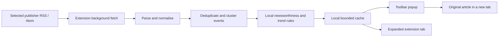

# News Browser — product and design plan

Status: original product plan. A first implementation is now available; see [README.md](README.md) for installation, implemented features and current limits. Updated 22 October 2026.

## Product promise and agreed constraints

Click the toolbar icon and understand the most important recent news in under a minute. Cover local, national and international events, explain why each story matters, and link directly to the reporting.

- Support desktop Chrome, Brave and Firefox from one shared codebase.
- Use only free data sources and free local processing. No paid APIs, API keys, trials, hosted backend, account requirement or paid AI service.
- Ask for country, optional region/city and news language during setup. Allow skipping to World news. Never infer a city from the browser timezone.
- Apply the seven newsworthiness values in the supplied image: impact, timeliness, proximity, prominence, conflict, the unusual and human interest.
- “Trending” means increasing coverage in the selected feeds. It does not mean verified readership or social popularity.

## Experience

### First opening

Use a short, skippable setup in the popup: choose location and language, then optional interests and sources. Ask for access to selected feed domains when enabling them. Show World news immediately if setup is skipped; invite the user to choose a location when they open Local.

Use a bundled, searchable location catalogue with country and administrative region. Local coverage requires a matching regional feed or a sufficiently clear place match in the article metadata. Ambiguous city names must include country/region context. Avoid a paid geocoder or permission for precise location.

### Every subsequent opening

1. Restore the previous view, filters and scroll position.
2. Render cached headlines immediately, with the last successful check time.
3. Refresh due feeds in the background and announce new stories through an “N new stories” button. Do not reorder the list beneath someone reading it.
4. Open the original article in a new browser tab when its headline is clicked. Persist state before navigating because the popup may close.

### Main navigation

| View | Purpose | Ordering |
| --- | --- | --- |
| Top | The most newsworthy recent events across enabled sources | Newsworthiness with a small coverage-trend contribution |
| Latest | The newest reporting | Valid publication time, newest first; undated items separately |
| Local | Events relevant to the chosen city or region | Local relevance, then newsworthiness; label wider regional fallbacks |
| World | Events outside the selected home country; all international coverage if no home country is chosen | Newsworthiness across regions |

Topic chips filter the active view. A small “Trending topics” row shows the fastest-growing topics within observed feeds, with a tooltip explaining its scope. Saved stories and settings sit behind labelled toolbar controls; search and detailed source management live in an expanded extension tab.

### Story card

- Publisher name, publication age, location where known and content type where supplied.
- Original headline, wrapping naturally; no automatic sensational rewriting.
- Optional short publisher-provided description, subject to source terms. Omit when unavailable.
- At most two explanatory labels, such as “High impact” and “Near you”.
- “Why this matters” expands the supported ranking reasons and any limits of the metadata.
- “4 reports” opens the related reporting list. A report count is not a verification badge.
- Save and hide controls with accessible labels; hide offers undo.
- Display known paywall status. Article access depends on the publisher; free extension access cannot make paid articles free.

Group reports about the same event into one card. Let users choose the reporting source rather than silently presenting one outlet as definitive.

## Visual design

See [popup-design.svg](popup-design.svg) for the illustrative layout. Its stories and counts are fictional samples.

- A 440 × 580 CSS-pixel popup as the starting layout, with one scrolling news list and fixed navigation/footer. Adapt for browser constraints and enlarged text.
- Calm editorial style: warm off-white background, white cards, charcoal text, deep teal active controls, generous spacing and subtle borders.
- Follow the operating system theme, with an explicit light/dark preference. Use the same hierarchy in both.
- Headline text around 17–18 px, body 14–16 px and metadata 12–13 px; system fonts bundled through the platform, without external font requests.
- Use a consistent spacing scale, visible keyboard focus and labelled controls with comfortable hit areas. Meaning must remain clear without colour.
- No carousel, autoplay, flashing breaking-news banner or default push notifications. Offer a finite brief with “Load more” rather than endless scrolling.
- Target WCAG 2.2 AA; verify contrast, keyboard order, screen-reader labels, reduced motion and text enlargement during implementation.

Browser popup sizing varies; Firefox documents an upper size of 800 × 600 when screen space permits. Test the proposed dimensions on all target browsers and small displays. [Mozilla popup documentation](https://developer.mozilla.org/en-US/docs/Mozilla/Add-ons/WebExtensions/user_interface/Popups)

## Newsworthiness and popularity

The weights below are initial product choices, not an objective journalism standard. Tune them against a reviewed set of local and international stories.

| Value from the reference | Initial weight | Evidence used |
| --- | ---: | --- |
| Impact | 25% | Explicit consequences for public services, safety, livelihoods or affected populations |
| Timeliness | 25% | Publication age and genuinely new reporting about a recent development |
| Proximity | 20% | Event place and relevance to the selected locality/country |
| Prominence | 10% | Named public institutions or people with a relevant role |
| Conflict | 8% | Explicit disagreement, dispute or struggle described in the metadata |
| Human interest | 7% | Clear personal experiences, community effects or acts of assistance |
| The unusual | 5% | Explicit evidence of rarity or novelty; an unusual adjective alone is insufficient |

For each value, assign a bounded 0–1 estimate using documented local rules. Keep the supporting text and a confidence level. Unknown evidence contributes no positive boost and remains marked unknown; this creates a known disadvantage for sparse feeds, which the evaluation must measure. Short headlines cannot reliably establish every value. Never present the resulting score as a truth or credibility rating.

**Default Top ranking:** 90% newsworthiness + 10% coverage trend, both normalised. Interests act as explicit topic filters in the first version. They do not quietly alter the general Top ranking.

**Timeliness:** start with a six-hour recency half-life and a 48-hour candidate window. Preserve publication, update, first-seen and last-checked times separately. Re-fetching an unchanged article must not make it new. Unknown dates receive an “Undated” label; suspicious future dates receive no freshness boost. An old event can return only with a clearly new development.

**Coverage trend:** compare new event reports in the last two hours with the previous two-hour window, normalise by each source's publishing volume and cap the contribution. Count distinct editorial origins where attribution is available; collapse identifiable wire copies. Otherwise label the number as reports, not independent confirmations. On first install, show “Collecting trend history” until enough observations exist. Do not invent a trend when data is missing.

**List diversity:** prefer different events, topics, publisher groups and regions when similarly ranked stories are available. Start with a maximum of two lead cards from one publisher group in the first ten; relax this when it would hide important available reporting. A unique local story can rank highly without widespread coverage.

**Explanation example:** “Near your selected region · published 25 minutes ago · reports describe disruption to public transport.” Only show the impact explanation when the supplied metadata supports it.

The first version uses lightweight dictionaries, place matching, topic labels and headline similarity. Human review is required to calibrate the rules. Reliable semantic impact assessment across all languages is beyond this free first version; support languages only when their rules and clustering have been evaluated.

## Free news sources

Fetch RSS/Atom directly from publishers through the extension. Each source entry records its feed URL, editorial origin, country, language, locality, topics, permitted display fields, refresh interval and terms reference. Prioritise popular international and national outlets alongside regional publishers; source inclusion should have a published rationale and user controls.

Initial candidates to validate include Guardian section feeds, BBC World feeds, DW language feeds and Al Jazeera English, plus regional feeds appropriate to the location chosen at setup. These are candidates, not a promise of unrestricted reuse. Check access and permitted use before enabling a bundled source; exclude any source that needs a paid licence for the intended use. Guardian documents personal, non-commercial RSS use. [Guardian RSS guide](https://www.theguardian.com/help/feeds)

BBC provides a feed directory; applicable source terms still need checking for the chosen distribution. [BBC feed directory](https://support.bbc.co.uk/platform/feeds/NewsFeeds.htm)

Do not depend on unofficial scraping, a public CORS proxy, Google News scraping, free trials, or a cloud free tier that could later require billing. If a feed disappears, retain the remaining sources and label the coverage gap.

When local coverage is insufficient, say “No recent city stories in your selected sources” and offer the wider region or country. A publisher's home country does not establish an event's location. Keep World coverage available regardless of local source availability.

No news API is required. NewsAPI's free Developer plan is restricted to development, and GNews documents a 12-hour delay on its free tier, making these poor dependencies for this product. [NewsAPI plans](https://newsapi.org/pricing), [GNews documentation](https://docs.gnews.io/?lang=en)

## Architecture

- Use TypeScript, a lightweight popup UI and bundled CSS. Keep framework and build-tool choices secondary to startup speed and cross-browser support.
- Produce Manifest V3 builds for Chromium and Firefox. Chrome and Brave share the Chromium package; test Brave separately. Brave supports nearly all Chromium-compatible extensions. [Brave extension support](https://support.brave.com/hc/en-us/articles/360017909112-How-can-I-add-extensions-to-Brave)
- Share feed, ranking, cache and UI modules. Use browser-specific background manifests: Chrome uses a service worker, while Firefox supports background scripts rather than that service-worker key. [Mozilla background compatibility](https://developer.mozilla.org/en-US/docs/Mozilla/Add-ons/WebExtensions/manifest.json/background)
- Bundle an XML parser that works without a DOM so feed parsing also works inside Chrome's service worker. Do not assume `DOMParser` exists there.
- Store bounded article/event history in IndexedDB and preferences in extension local storage. Keep seven days of observations, cap the cache by item count and bytes, and prune transactionally. Saved links and metadata have a separate user-visible cap.
- Use extension alarms and on-open refresh checks. Persist progress; do not rely on background globals or continuously running timers.
- Start at a 15-minute polling interval, or slower when a publisher requests it. Use conditional requests where supported, limited concurrency, request timeouts, jitter and exponential backoff. A manual refresh respects per-feed cooldowns.
- Polling is best effort while the browser runs. “Latest” means latest available from successfully checked feeds, not real-time alerts or comprehensive coverage.
- Request `storage`, `alarms` and selected feed-host access. Request optional host access when adding a source. Fetch from the extension background context; Chrome permits these cross-origin requests with appropriate host permissions. [Chrome network requests](https://developer.chrome.com/docs/extensions/develop/concepts/network-requests)
- No history access, content scripts, page scanning, remote executable code or browsing-based personalisation. All scoring happens locally.
- Treat feed content as untrusted: plain text rendering, bounded XML input, disabled external entity resolution, safe HTTP(S) article links and controlled redirects. Never inject raw feed HTML.
- Disable remote article images by default to reduce requests and tracking. If later enabled, explain that publisher/image hosts receive network requests. Feed providers also see direct feed requests; local processing does not make these requests anonymous.

Core records: `Source`, `Article`, `EventCluster`, `ScoreEvidence`, `TrendObservation`, `Preferences`, `SavedStory`, and `FeedHealth`. Keep publisher identity separate from editorial origin and event location.

## Loading and failure states

| State | Behaviour |
| --- | --- |
| First load with no cache | Stable skeleton, then progressive results as feeds respond |
| Refresh with existing stories | Keep stories readable; show check progress and new-story button |
| Offline | Show cached stories and the last successful check; retain save actions |
| One feed fails | Keep other results; mark that source's health and retry later |
| Rate limit or access denial | Back off; offer disable/retry in source settings |
| Empty local view | Explain coverage limits; offer wider region or source settings |
| Missing description or image | Preserve the same card structure with headline and attribution |
| No trend history | Hide trend claims and explain that observations are being collected |

## Delivery plan and release checks

1. **Validate free source coverage.** Check live feed parsing, terms, language and local availability. Exit when a useful free catalogue exists for the first supported regions, with an explicit fallback elsewhere.
2. **Build the reading experience.** Implement setup, popup, preferences, cached news, Latest/Local/World, source management and original-article navigation. Exit when the same core flow works in all three browsers.
3. **Add editorial ranking.** Implement all seven values with evidence, conservative event clustering, Top ranking and observed topic trends. Exit when reviewers can explain and assess the ordering on a curated multilingual/region-appropriate sample.
4. **Polish and package.** Add saves, accessibility, themes, empty/error states, cache limits and release documentation. Exit when browser checks and zero-paid-dependency checks pass.

Acceptance checks for implementation:

- Cached content visible within 300 ms at the 95th percentile on a documented reference device; network time does not block cached rendering.
- Keyboard-only setup, navigation, saving and source selection; readable enlarged text and screen-reader announcements without stealing focus.
- Source timestamps, check times, missing dates and stale content remain distinguishable.
- Test local place ambiguity, old articles reappearing, future timestamps, syndicated duplicates and unrelated stories with similar titles.
- Evaluate event grouping precision and ranking against a reviewed story set; favour keeping ambiguous reports separate over incorrectly merging them.
- Local impact can outrank a widely repeated celebrity item; human-interest stories remain eligible without conflict.
- Offline mode, denied feed permissions, malformed/oversized XML and a stopped background process do not erase cached news.
- Every displayed ranking explanation has evidence; no “most read”, “verified” or comprehensive-coverage claim is inferred from report counts.
- No paid dependency, billing account, API key, backend deployment or external AI service is needed to run the extension.

## Zero-cost distribution boundary

The planned extension has no paid runtime service and can be free for users. For a strictly zero-spend development path, load the unpacked extension in Chrome/Brave and use Firefox's signed distribution process for releases. Chrome Web Store publishing requires a one-time developer registration fee; exclude that publishing route from a strict $0 budget. [Chrome developer registration](https://developer.chrome.com/docs/webstore/register), [Firefox signing and distribution](https://www.extensionworkshop.com/documentation/publish/signing-and-distribution-overview/)

The extension links to publisher articles. Their paywalls, feed availability and publication schedules remain outside its control.
