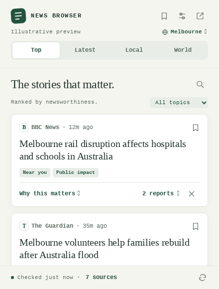

# News Browser

A free browser extension that opens a quiet, useful news brief from the toolbar. It combines publisher RSS/Atom feeds, clearly labelled Google News feeds and optional public social feeds, processing stories in your browser. No API keys, paid services, account or backend are required.



Illustrative local brief. Country, city and sources are chosen during setup; the screenshot uses fictional reporting.

## Install in Chrome or Brave

Use a browser package from [GitHub Releases](https://github.com/LocalCiggyShop/news-browser/releases) when available. For a source checkout, run `python3 scripts/build.py` from the repository folder to create `dist/`; this build step needs Python 3 only, with no npm installation. In the original development workspace, the packages are already built.

1. Open `chrome://extensions` in Chrome, or `brave://extensions` in Brave.
2. Turn on **Developer mode**.
3. Click **Load unpacked** and select this project's **`dist/chrome`** folder. Select the folder containing `manifest.json`, not the ZIP.
4. Pin **News Browser** from the browser's extensions menu.
5. Click its icon, then **Set up your brief**. Choose a location if desired, select sources, and save. Allow access to the selected feed domains when the browser asks.

For example, if you keep the project in a `News Browser` folder, select:

```text
News Browser\dist\chrome
```

Keep that folder in place while the extension is installed. After rebuilding, use **Reload** on the browser's extensions page.

## Install in Firefox

Requires Firefox 142 or newer. For a free temporary development installation:

1. Open `about:debugging#/runtime/this-firefox`.
2. Click **Load Temporary Add-on**.
3. Select **`dist/firefox/manifest.json`**.
4. Use the toolbar icon to set up your brief.

Firefox removes temporary add-ons when it restarts. The ZIP at `dist/news-browser-firefox.zip` is a build artifact, not a Mozilla-signed release. A permanent release needs Mozilla signing; see [Firefox's signing and distribution documentation](https://www.extensionworkshop.com/documentation/publish/signing-and-distribution-overview/). Nothing has been published to a store.

## Included

- **Top:** recent events ranked using impact, timeliness, proximity, prominence, conflict, human interest and the unusual.
- **Latest:** original publication times, newest first. Undated or suspicious future-dated reports do not get a freshness advantage.
- **Local:** city mentions in matching country context, followed by explicitly labelled wider country coverage.
- **World:** international feeds, with a conservative filter for clearly domestic mentions.
- Related-report grouping and a **Why this matters** explanation for every story.
- Topic filters, search, saved links, hide/undo and an expanded reading view.
- System/light/dark themes, keyboard controls, reduced-motion support and screen-reader labels.
- Publisher selection, custom HTTPS RSS/Atom feeds, feed-health information and saved-link export.
- Cached reading when offline. Background checks every 15, 30 or 60 minutes while the browser runs.

The catalogue has 22 presets, including CNN, NPR, PBS, CBS, ABC News US, BBC News, The Guardian, Al Jazeera, DW, France 24, Sky News, CBC, RNZ, ABC News Australia, SBS, NASA, WHO and UN News. Some publishers have both international and national feeds. Search or filter the catalogue to find publishers, topics, primary sources and services for your country.

Suggested defaults follow the country chosen during setup. US suggestions include CNN, NPR and PBS; Australian suggestions include ABC News Australia and Guardian Australia; UK suggestions include BBC UK and Sky UK. World view starts with international feeds. Existing saved source choices remain intact; **Use suggested sources for this location** applies a new selection explicitly.

Add a city or region for an optional local-publisher feed, scoped to that place and country. Local services are shown under their own publisher names when available. CNN and local discovery use Google News RSS because a working direct CNN HTTPS feed could not be verified. Both are labelled **via Google News**; their links open through Google News. These RSS endpoints are not a contracted API and can change. The rest of the extension continues working if an aggregator feed fails. A direct regional publisher RSS feed can also be added manually.

**Social channels:** add Bluesky handles or Mastodon accounts for free public-post feeds. Reposts and replies from Bluesky are excluded; private content and platform interactions are not requested. X handles become profile shortcuts in the popup, with no X access permission. X posts are not automatically imported because the [official X reading API is paid](https://docs.x.com/x-api/getting-started/pricing).

A publisher may block requests or change a feed; each source fails independently. Review publisher feed terms for your use; the extension is designed as a personal feed reader, not a content redistribution service.

## What the ranking means

English-language rules look for evidence in supplied headlines and descriptions. The initial weights are impact 25%, timeliness 25%, proximity 20%, prominence 10%, conflict 8%, human interest 7% and the unusual 5%. Missing evidence adds no boost. With no home country, the unused proximity weight is redistributed.

Top uses 90% estimated newsworthiness and up to 10% coverage growth. Trend estimates require four hours of observations; the first fetch of each feed is excluded as backfill. “Gaining coverage” reflects these selected feeds, not reader counts. Grouped reports can share an editorial origin and do not prove that a claim is true.

This first version supports English ranking and manual country/city selection. It does not assess factual accuracy, infer exact event locations, translate articles or guarantee comprehensive local coverage. Rule-based story grouping and ranking are approximate. Publisher articles can have paywalls even though the extension itself requires no paid service.

## Privacy and permissions

See [PRIVACY.md](PRIVACY.md). Feed-host access is optional and requested only after selecting sources. It is used by the background fetcher; there are no content scripts and no browsing-history access. Settings, saved links, ranking and cached news stay on the device. Publishers and feed services receive requests and can see ordinary connection information such as the IP address. Enabling local discovery shares the chosen city/country query with Google News; following a Bluesky or Mastodon feed shares the requested account with that service. Remote images, analytics and notification services are not used.

## Develop and verify

The extension uses native JavaScript modules, HTML and CSS, without runtime dependencies. Python 3 builds packages using its standard library; Node 22+ runs the automated checks.

```sh
npm ci
npm test
python3 scripts/build.py
npx playwright install chromium
npm run test:browser
```

On Linux, Playwright needs its documented browser system dependencies. If they are absent, follow [Playwright's browser installation instructions](https://playwright.dev/docs/browsers#install-system-dependencies).

`npm run test:browser` loads the actual extension code in Chromium. A temporary test-only manifest pre-grants feed hosts to avoid native permission dialogs in headless automation. Network responses are synthetic and screenshots are labelled as illustrative. The distributed manifests retain optional host permissions. The suite covers setup, cache fetching, duplicate grouping, ranking explanations, saves, hide/undo, local news, filters, search, offline reopening, themes, responsive layout and safe text rendering.

```text
extension/           Runtime source and Chrome manifest
extension/core/      Feed parsing, ranking, cache and source catalogue
scripts/build.py     Chrome/Brave and Firefox builds, icons and ZIPs
tests/               Core and browser checks
dist/chrome/         Load unpacked in Chrome or Brave
dist/firefox/        Load temporarily in Firefox
artifacts/           Browser-test screenshots
```

The original [product plan](NEWS_BROWSER_PLAN.md) and [concept mockup](popup-design.svg) are retained. The implemented UI can be previewed by installing the extension; generated test screenshots are in `artifacts/` after browser checks.

## Cost

There are no paid runtime dependencies. Unpacked Chrome/Brave installation has no store fee. Publishing through the Chrome Web Store requires a one-time developer registration payment, so it is outside the strict zero-spend path. [Chrome publishing requirements](https://developer.chrome.com/docs/webstore/register)
